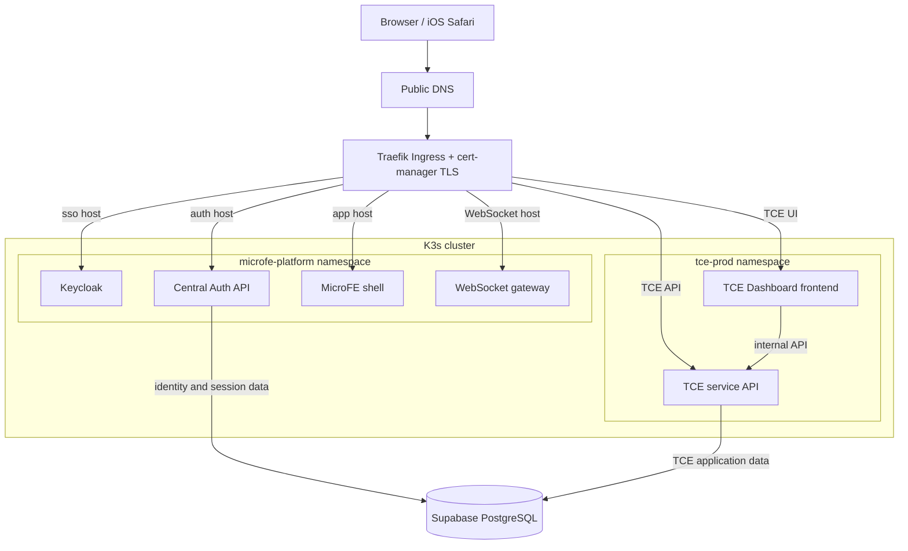
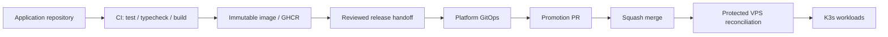

# Active infrastructure map: SSO, TCE Dashboard and platform services

> Current architecture scope for the active production composition. Treat checked-in manifests as desired state; verify live health separately before operational decisions.

## 1. System context

- Solid arrows represent declared routes or dependencies in checked-in manifests/configuration.
- A diagram is not proof of current pod, DNS, certificate, OIDC or database health.
- Never place credentials or secret values in architecture documentation.

## 2. Active ownership boundaries

| Component | Platform responsibility | Application responsibility |
|---|---|---|
| Production Kubernetes | Manifests, namespaces, ingress, TLS, Kustomize composition and protected reconciliation | Supply immutable, reviewed application images |
| TCE Dashboard | Deployment boundary, image promotion, runtime health and rollback | Frontend/service source, trading engines, market scanning, business logic and application tests |
| Central Auth | Runtime manifests, service exposure and protected rollout | Identity/session APIs, token validation, auth-specific tests and release artifacts |
| Keycloak | Runtime deployment, ingress/TLS and database connectivity boundary | OIDC client contracts and application integration are verified by each participating client |
| MicroFE shell and WebSocket | Shared platform shell/realtime infrastructure | Domain state and business rules remain in their owning application |

## 3. Identity and session contract

- Keycloak is the OIDC provider; Central Auth remains a separate service boundary.
- Verify the intended realm issuer and discovery document, not only a default realm endpoint.
- Resource servers validate signature, exact issuer, explicit audience, expiry and allowed algorithms.
- Browser-facing sessions should use a server-side BFF/HttpOnly Secure cookie boundary.
- Do not store bearer or refresh tokens in localStorage or pass credentials in URLs.
- Identity linking must use a stable issuer/subject mapping; matching email alone is not safe account linking.
- Role mapping is explicit and deny-by-default. Logout, revocation, expiry and outage behavior require end-to-end tests.
- A running identity provider or successful discovery probe does not establish that application SSO is complete.

## 4. Delivery and runtime control plane

- Application repositories own source, tests and image publication.
- Platform Infra owns production manifests, immutable image pinning, reconciliation and rollout/health verification.
- Never treat a published image or a manifest-validation result as proof of a healthy rollout.
- Routine production apply remains restricted to the protected reconciliation workflow and its allowlisted execution wrapper.

## 5. Verification before change

1. Render the active production composition and validate all referenced bases.
2. Compare immutable image references with the reviewed application release.
3. Check namespace, pod, ingress, certificate and endpoint health from a fresh read-only inspection.
4. Confirm the exact workflow event and commit; manual fallbacks do not prove native schedule freshness.
5. Preserve database, storage, DNS, runner and credential boundaries; destructive operations require a separate evidence-backed approval path.
