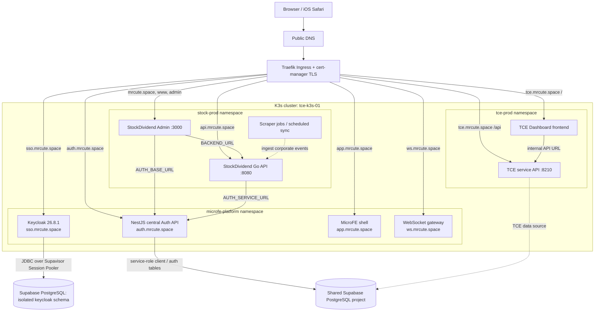
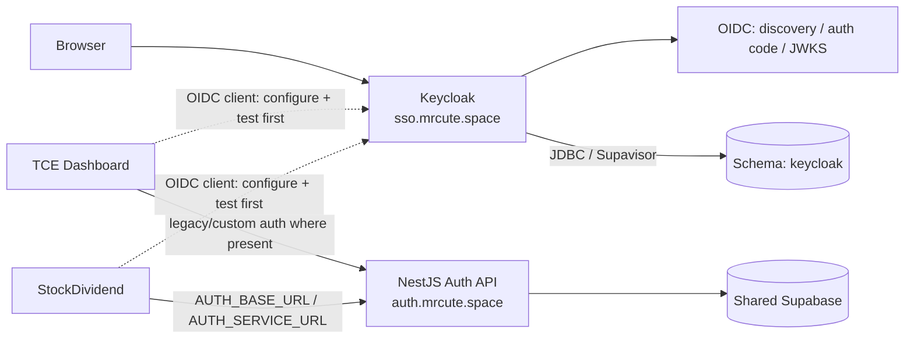

# Infrastructure map: SSO, TCE Dashboard, StockDividend

> Source of truth: current GitOps manifests and application README files in the linked repositories. This is a **declared/source architecture map**, not proof that every pod, DNS record, OIDC client or runtime secret is currently healthy. Last reviewed: 2026-10-26.

## 1. System context

### What the arrows mean

- Solid arrows show routes or dependencies declared in the checked-in manifests/configuration.
- Dashed arrows indicate an intended or README-documented dependency whose live runtime behavior needs separate verification.
- The shared Supabase project reference used in the repo docs is `gtqovpusfyyvxpeezxlo`; the Keycloak database role is intended to be isolated to schema `keycloak`. No credentials belong in this document.

## 2. Public ingress and application routing

| Host | Namespace / workload | Route or port |
|---|---|---|
| `sso.mrcute.space` | `microfe-platform/keycloak` | Traefik -> Service `keycloak:80` -> Keycloak HTTP :8080; TLS secret `keycloak-sso-tls` |
| `auth.mrcute.space` | `microfe-platform/microfe-auth` | Traefik -> Service `microfe-auth:80` -> NestJS :4010; TLS secret `auth-mrcute-tls` |
| `tce.mrcute.space/` | `tce-prod/tce-frontend` | Traefik -> Service :80 |
| `tce.mrcute.space/api` | `tce-prod/tce-service` | Traefik -> Service :8210 |
| `mrcute.space`, `www.mrcute.space`, `admin.mrcute.space` | `stock-prod/stock-admin` | Traefik -> Service :3000 |
| `api.mrcute.space` | `stock-prod/stock-backend` | Traefik -> Service :8080 |
| `app.mrcute.space` | `microfe-platform/microfe-shell` | Traefik -> Service :80 |
| `ws.mrcute.space` | `microfe-platform/microfe-ws` | Traefik -> Service :8080 |

TLS certificates are requested from cert-manager using the `letsencrypt-prod` ClusterIssuer. DNS must point each hostname to the existing public ingress address; DNS state is external to these manifests.

## 3. SSO / identity boundary

**Important boundary — SSO is not the same as “all apps already use SSO”.**

- Keycloak runtime manifests and public ingress are declared. The repo's SSO rollout document reports public Keycloak discovery for the `master` realm returns HTTP 200.
- The `mrcute` application realm, per-application OIDC clients, exact callback URLs, audience/role mappers and end-to-end app login must be configured and verified before describing TCE or StockDividend as migrated to SSO.
- NestJS Auth remains at `auth.mrcute.space` as a separate existing service. Its README documents an additive Keycloak-protected `GET /api/oidc/me` endpoint; legacy custom signup/login/session endpoints remain in place.
- StockDividend manifests explicitly set `AUTH_BASE_URL=https://auth.mrcute.space` for the admin UI and `AUTH_SERVICE_URL=http://microfe-auth.microfe-platform.svc.cluster.local` for the backend. This is a dependency on central Auth, not proof of OIDC client migration.
- Keycloak database configuration is isolated to schema `keycloak`. The infra README reports the dedicated role `keycloak_runtime` has no access to application user tables. A documented blocker is that the DB role password must be provisioned through a protected path and mirrored into the GitHub Environment secret; never place it in Git.

## 4. Application data paths

### TCE Dashboard

- Public UI: `https://tce.mrcute.space`.
- API route: `https://tce.mrcute.space/api` -> `tce-service:8210`.
- Frontend's internal API base in the current manifest is `http://tce-service:8210`.
- The application README identifies Supabase as the TCE data source. Verify the exact set of tables/RPCs used in the current code before planning DB changes.
- TCE authentication code exists in the application repository; do not assume that every route is already delegated to Keycloak.

### StockDividend

- Admin UI: `https://mrcute.space`, `https://www.mrcute.space`, `https://admin.mrcute.space` -> `stock-admin:3000`.
- API: `https://api.mrcute.space` -> `stock-backend:8080`.
- Admin uses `BACKEND_URL=http://stock-backend:8080` and `AUTH_BASE_URL=https://auth.mrcute.space`.
- Backend uses internal `AUTH_SERVICE_URL=http://microfe-auth.microfe-platform.svc.cluster.local` and a Kubernetes Secret named `stock-secrets` for its other environment variables.
- Repo README describes a Go backend, Next.js admin UI and a scheduled scraper. The production Kustomize overlay currently lists immutable-image tags for backend and admin. Verify the actual CronJob/schedule from live resources before relying on a schedule.

## 5. Delivery and runtime control plane

```mermaid
flowchart LR
  apprepo[Application Git repository]
  checks[CI: test / typecheck / build]
  image[Immutable image tag / GHCR]
  dispatch[repository_dispatch / release event]
  infra[platform-infra GitOps]
  pr[Image promotion PR]
  merge[Squash merge to master]
  reconcile[Protected VPS runner + reconcile-vps]
  k3s[K3s workloads]
  apprepo --> checks --> image --> dispatch --> infra --> pr --> merge --> reconcile --> k3s
```

- Application repos own source, tests and image builds.
- `platform-infra` owns Kubernetes manifests, production Kustomize overlays, image promotion and rollout/health verification.
- The declared production composition is `environments/prod/kustomization.yaml`, including Keycloak/auth platform resources, StockDividend, TCE and Media Generation.
- The generic release contract requires verification before publishing, immutable tags, GitOps promotion, then K3s reconciliation and health checks. Never treat a GitHub image publish as proof of successful rollout.

## 6. Secret and trust boundaries

| Secret / trust boundary | Intended owner / location | Rule |
|---|---|---|
| Keycloak DB URL/user/password | Protected GitHub Environment -> Kubernetes Secret `keycloak-runtime-secrets` | Do not commit or log credentials; use dedicated role/schema |
| Keycloak bootstrap admin credentials | Protected GitHub Environment -> Kubernetes Secret `keycloak-runtime-secrets` | Never expose in outputs/artifacts; master realm stays admin-only |
| NestJS Auth secrets (`JWT_SECRET`, `MFA_ENCRYPTION_KEY`, Supabase service key) | Protected runtime Secret in `microfe-platform` | Backend only; never browser/client-side |
| StockDividend `stock-secrets` | Kubernetes Secret in `stock-prod` | Keep values out of manifests/docs |
| App-to-service traffic | Cluster-internal Service DNS where declared | Do not assume it is externally authenticated just because it is internal |
| OIDC token validation | Each resource server/client integration | Validate issuer, audience, signature, expiry and supported algorithm; avoid decode-only JWT parsing |

## 7. Verification gaps / next actions

This diagram intentionally separates declared design from runtime facts. The following checks remain necessary before claiming full SSO integration:

1. Verify Keycloak discovery and the `mrcute` realm issuer, not only `master`.
2. Provision/verify exact OIDC clients and callback URLs for TCE and StockDividend; use authorization code + PKCE for browser clients.
3. Prove token validation at every protected API: signature/JWKS, issuer, audience, expiry, role mapping, logout/session semantics.
4. Confirm the Keycloak runtime DB password secret is provisioned without printing its value; validate the connection over TLS and bounded pooler configuration.
5. Render `kubectl kustomize environments/prod` and compare output image references against GitOps intent; validate live namespaces, pods, ingress, certificates and endpoints.
6. Confirm StockDividend scraper scheduling and the current status of migration execution separately; do not infer these from the application README.
7. Run end-to-end login and authorization tests for both applications in a non-production flow before any client traffic cutover.

## Source files

- [Keycloak runtime overview](../platform/keycloak/README.md)
- [Keycloak Deployment, Service and probes](../platform/keycloak/deployment.yaml)
- [Keycloak public Ingress](../platform/keycloak/ingress.yaml)
- [Existing Auth API Deployment and Service](../platform/auth-service/deployment.yaml)
- [Central Auth / OIDC integration contract](https://github.com/phanthienquoc/phanthienquoc-authentication#keycloak-identity-metadata-in-supabase)
- [TCE production Ingress](../apps/tce-dashboard/overlays/prod/ingress.yaml)
- [StockDividend production Ingress](../apps/stockdividend/overlays/prod/ingress.yaml)
- [Production composition](../environments/prod/kustomization.yaml)
- [Generic release pattern](./GENERIC-WF03-RELEASE-PATTERN.md)
- [Keycloak SSO activation prerequisites](./auth-central/keycloak-self-registration.md)
