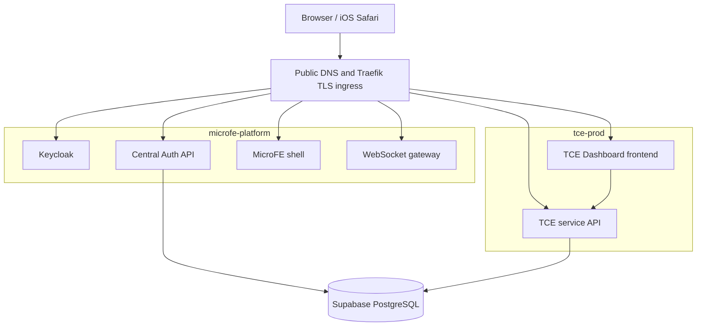
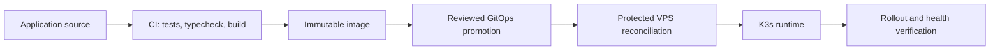

# Platform System Design & Safe-Change Contract

**Scope:** Active Platform Infra, TCE Dashboard, Authentication, Keycloak and shared MicroFE services. This document defines ownership and safe change boundaries; checked-in manifests remain the desired-state source of truth, while live health must be verified separately.

## 1. System ownership and boundaries

| Area | Owner | Boundary |
|---|---|---|
| Kubernetes, ingress, TLS, production Kustomize and VPS reconciliation | Platform Infra | Sole production apply authority; protected allowlisted execution only |
| TCE frontend/service, market scanning, trading engines and business logic | TCE Dashboard | Owns application source, tests, release artifacts and trading decisions |
| Identity/session APIs and auth-specific behavior | Authentication | Owns application source, identity contract and auth release artifacts |
| Keycloak runtime, ingress and database connectivity | Platform Infra | OIDC clients and application-side token/session integration must be verified independently |
| MicroFE shell and WebSocket gateway | Platform Infra | Shared browser/realtime infrastructure; domain state remains in application repositories |
| Supabase data plane | Application/service owners | Schema, data, RLS and role changes require a separate evidence-backed review |

No application repository may bypass the protected Platform reconciliation lane to mutate production Kubernetes directly.

## 2. Active topology

The diagram expresses intended ownership and declared dependencies, not proof of current pod readiness, public DNS, certificate validity, OIDC health or database connectivity.

## 3. Production deployment path

- Application repositories own source, tests and immutable image publication.
- Platform Infra owns production manifests, image pinning, GitOps reconciliation, rollout and health verification.
- `.github/workflows/reconcile-vps.yml` is the sole routine production apply authority.
- `.github/workflows/inspect-vps.yml` is read-only and must not mutate workloads.
- Successful CI, image publication, manifest rendering or a manual fallback does not independently prove a healthy production rollout.
- Production image changes require a reviewable promotion and exact-head validation; routine reconciliation must not invent or silently change image tags.

## 4. Authentication and browser trust boundary

- Keycloak is the OIDC provider; Central Auth remains a separate service boundary.
- Verify the intended realm issuer and discovery document, not only a default realm endpoint.
- Resource servers validate signature, exact issuer, explicit audience, expiry and allowed algorithms.
- Browser sessions should use a server-side BFF and HttpOnly Secure cookies; never place client secrets in browser bundles.
- Do not persist bearer or refresh tokens in localStorage or pass credentials in URLs.
- Identity linking uses a stable issuer/subject mapping; matching email alone is not safe account linking.
- Roles are mapped explicitly and deny by default. Test logout, revocation, expiry, CSRF, outage and legacy fallback behavior.
- A running identity provider or successful discovery probe is not proof of end-to-end SSO.

## 5. Supabase and data-plane contract

- Treat production data, schemas, RLS policies, roles and migrations as high-risk state.
- Inspect the exact migration and its rollback/backup plan before execution.
- Do not infer that a database project, schema or role is approved from a connection string or repository reference.
- Never print credentials, tokens, service-role keys or credential-bearing URLs in logs, artifacts, PRs or documentation.
- Keep data access least-privileged and server-side; frontend bundles must not receive service credentials.
- Do not perform DDL/DML, policy changes, credential rotation or data deletion as an incidental deployment step.

## 6. Credentials and configuration

- Runtime credentials are injected through the approved protected path; source control contains names/contracts only, never values.
- Do not inspect or modify GitHub Environment configuration, variables or secrets during this repository cleanup.
- Redact sensitive values from command output, logs and generated inspection snapshots.
- Keep read-only audit credentials separate from deployment or deletion credentials.

## 7. K3s and GitOps boundaries

- Use the approved `platform-kubectl` wrapper and its explicit allowlist; do not bypass it with raw cluster access.
- Routine reconciliation is bounded, observable and idempotent.
- Inspection workflows are read-only. They must not scale, restart, patch, delete or apply workloads.
- Preserve shared platform services, TCE and Authentication unless a separate reviewed change authorizes a change.
- Destructive retirement remains a separate manual, fail-closed workflow with same-run storage checks, runner absence, external backup/retention, DNS ownership and protected approval gates.
- Never delete or unregister the shared Platform runner.
- Preserve TCE market-scan automation and its existing schedule.

## 8. Safe change protocol

### Phase A — Discover
1. Re-read the live default branch, PR state, exact workflow definitions and target file contents.
2. Establish current desired state and separate it from stale snapshots or inferred runtime state.
3. Identify blast radius, owners, dependencies, rollback and required evidence.
4. Do not inspect secret values or GitHub Environment configuration.

### Phase B — Change
1. Create a dedicated branch; never work directly on main/master.
2. Make the smallest coherent change and preserve unrelated platform/TCE behavior.
3. Keep high-risk or irreversible operations behind explicit approval and fail-closed guards.
4. Never rewrite shared Git history or force-push.

### Phase C — Validate
1. Run relevant unit/regression tests, shell syntax checks, workflow-contract validators and manifest rendering.
2. Search the changed scope for stale references, broken links and accidental secret material.
3. Validate exact PR head and required checks; do not claim success without observed results.
4. Reconcile runtime only through the approved workflow and only when authorized.

### Phase D — Review and verify
1. Open or update a PR with a clear summary, safety boundary and validation evidence.
2. Use squash merge when an authorized merge is requested.
3. Verify the merged commit and post-merge checks.
4. Verify runtime health separately from GitOps merge status.

## 9. Change risk matrix

| Risk | Examples | Required handling |
|---|---|---|
| Low / reversible | Documentation, isolated tests, non-production formatting | Dedicated branch, focused diff, relevant checks |
| Medium | Workflow logic, image promotion contract, deployment configuration | PR review, exact-head CI, rollback plan and owner notification |
| High / irreversible | Production data deletion, credential rotation, namespace deletion, DNS cutover, runner removal | Explicit authorization, same-run evidence, protected approval and verified rollback/retention plan |

## 10. Evidence vocabulary

- **Declared:** present in checked-in source or manifests.
- **Validated:** a named test or validator passed on an exact commit.
- **Observed:** a timestamped read-only runtime inspection returned the stated result.
- **Verified:** independent evidence supports the claim and its scope.
- **Unknown:** evidence is missing, stale, ambiguous or inaccessible.
- **Blocked:** a required gate failed or evidence is insufficient.

Never convert a declared or stale observation into a verified production claim.
