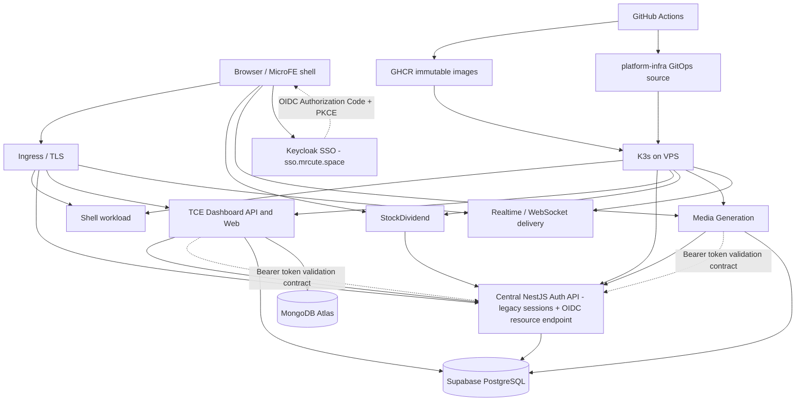
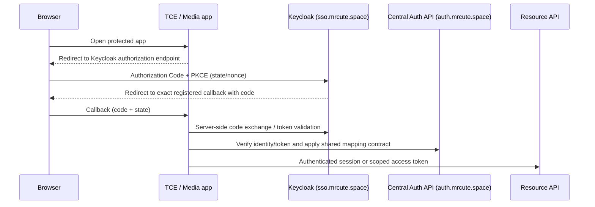

# Platform System Design & Safe-Change Contract

**Status:** Living architecture reference — source-backed, with explicit unknowns  
**Audited:** 2026-10-26  
**Owner:** `platform-infra` for Kubernetes/GitOps; each application repository owns its application behavior  
**Purpose:** Prevent unsafe cross-system changes, accidental production side effects, data loss, incompatible auth/session changes, and unnecessary disruption.

> This document is an operational guardrail, not blanket approval to deploy, migrate databases, rotate credentials, or change production. A green CI run proves only the checks it ran; it does not prove that production is healthy or database history is reconciled.

## 1. System ownership and boundaries

| Concern | Authoritative owner | What this repository may do | What it must not do |
|---|---|---|---|
| Kubernetes manifests, Kustomize overlays, ingress/cert references, immutable image promotion, VPS reconciliation | `phanthienquoc/platform-infra` | Declare workloads, validate/render manifests, promote explicit immutable image refs, perform scoped reconciliation | Become a second copy of application source or silently change application behavior |
| TCE application, strategy/engine and service implementation, TCE-owned migrations | `phanthienquoc/TCE-dashboard` | Consume immutable built images; host only deployment configuration | Reimplement in infra; submit live trading orders as part of deploy/verification |
| Central Auth API, identity/session/RBAC behavior and Auth-owned migrations | `phanthienquoc/phanthienquoc-authentication` | Deploy a verified immutable Auth image and provide runtime Secret references | Clone Auth state/logic, invent parallel sessions, or run app DB migrations as an incidental deploy side effect |
| Media application and app-owned migrations | `phanthienquoc/media-generation` | Preserve its existing workload and image contracts | Modify the application repo as part of an infra task or change its live data behavior incidentally |
| Supabase PostgreSQL project | Existing shared external data dependency; owner confirmed it is their production project on 2026-10-26 | Keep runtime Secret references, document verified interfaces, follow the owning migration process after exact action review | Assume repo migration files equal live schema; run blind `db push`; reset/branch-merge/delete data; use service-role key in browser/logs |
| GitHub Secrets and protected Environment values | GitHub repository/environment scopes and protected Kubernetes runtime Secret provisioning | Refer to secret **names** and ensure key references are present | Copy values into Git, Markdown, artifacts, command output, logs, issue comments or Telegram |

Source links:
- [Platform Infra README](https://github.com/phanthienquoc/platform-infra/blob/master/README.md)
- [MicroFE platform contract](https://github.com/phanthienquoc/platform-infra/blob/master/docs/microfe-platform-contract-v1.md)
- [MicroFE deployment contract](https://github.com/phanthienquoc/platform-infra/blob/master/docs/microfe-nestjs-migration.md)
- [Credentials key index](https://github.com/phanthienquoc/platform-infra/blob/master/docs/credentials-key.md)

## 2. High-level topology

**Diagram caveat:** This is a logical relationship map, not a claim that every listed application currently reads Supabase or that every ingress route is live. Each app-to-database edge, live pod state, current image digest, DNS/TLS, and network reachability must be verified before an operation that depends on it. Do not infer runtime health from YAML alone.

## 3. Production deployment path

The declarative deployment path is:

1. Application repository tests and builds an image.
2. Publish an immutable Git-SHA/digest image to GHCR.
3. A scoped release handoff or approved promotion updates the appropriate image reference in `platform-infra`.
4. Manifest validation renders `environments/prod` and checks YAML, first-party image policy, secret references, and network boundaries.
5. `reconcile-vps.yml` is the actual VPS/K3s reconciliation path. It is triggered by manual dispatch, repository dispatch, a schedule every 15 minutes, and selected pushes to `master`. Schedule/push/repository-dispatch currently set effective mode to `apply`; repository dispatch can permit image changes for the `gitops-promoted-ready` event. Treat those triggers as production-capable.
6. Inspect rollout status/health and reconcile drift before declaring completion.

Relevant source:
- [Production Kustomize entrypoint](https://github.com/phanthienquoc/platform-infra/blob/master/environments/prod/kustomization.yaml)
- [reconcile-vps workflow](https://github.com/phanthienquoc/platform-infra/blob/master/.github/workflows/reconcile-vps.yml)
- [validate-manifests workflow](https://github.com/phanthienquoc/platform-infra/blob/master/.github/workflows/validate-manifests.yml)

### Deployment safety rules

- Never assume a docs-only PR has no operational effect until all triggered workflows and downstream dispatches have been inspected.
- Before merging **any** PR, inspect path filters, triggers, workflow inputs/defaults, dispatch payloads, self-hosted runners, protected Environments, and whether the merge can run an apply, promote images, provision secrets, or restart workloads.
- `workflow_dispatch` with `mode=apply` is a production action. `target_app=all` can affect multiple workloads.
- Prefer the narrowest `target_app` and an explicit intended action; keep `allow_image_changes=false` unless a reviewed image promotion explicitly requires otherwise.
- Preserve immutable image references. Never use `latest`, mutable convenience tags, or guessed SHAs for production.
- A successful manifest render is not a live-cluster health check. A successful deploy workflow does not prove API/session compatibility or database correctness.
- Do not merge or rerun unrelated pending production actions simply to make CI green.
- Do not bypass branch protections or required checks.

## 4. Authentication and browser trust boundary

The platform contract declares a self-hosted Auth API; Supabase Auth is **not** the browser authentication surface.

- Central NestJS Auth owns identity, password checks, MFA/recovery, passkeys, sessions, refresh rotation/reuse detection, revocation, RBAC, CSRF, rate limits, audit events and request IDs.
- Browser sessions use the existing HttpOnly cookie/session boundary. Never move authentication material into localStorage, URLs, client logs or analytics.
- The browser must not access the Supabase service-role client/key or query privileged tables directly.
- TCE, StockDividend, Media Generation and other clients consume the shared Auth contract; do not create parallel password/session stores in each app.
- Server-to-server auth and browser auth are separate contracts. Do not assume a cookie is a Bearer token or that an endpoint accepts both.
- Keep JWT issuer, audience, signing algorithm and claims compatible with all consumers. Do not rotate secrets or change token claims without an explicit compatibility plan and coordinated rollout.
- Preserve refresh-cookie path/domain/SameSite/Secure semantics unless tests prove the new contract works across every consumer.
- Privileged role changes must deny by default; no public admin bootstrap, no signup-controlled ADMIN role, no self-escalation or last-admin lockout.
- Authorization, audit logging and failure behavior must be tested before enabling mutation endpoints.

### Known contract gates from source review

The existing Auth evidence document identifies possible route-prefix, cookie-path, cookie-only `/auth/me`, and JWT issuer/audience mismatches across consumers. These are **compatibility gates to resolve with source and integration tests**, not permission to change URLs or token rules opportunistically.

See [Auth Central phase 0/1 evidence](https://github.com/phanthienquoc/platform-infra/blob/master/docs/auth-central/phase-0-1-evidence.md).

### Keycloak SSO status and integration contract (2026-10-26)

**Important distinction:** Keycloak is an existing infrastructure workload/SSO candidate, but that does **not** mean every application is already an OIDC client or that production SSO is fully enabled.

Source review found the following:

| Repository / component | Source-verified capability | Gap before end-to-end SSO |
|---|---|---|
| `platform-infra` | Keycloak workload manifests, dedicated `sso.mrcute.space` ingress/certificate, isolated deployment lane and secret-name contract exist in the repository. Platform docs report Keycloak 26.8.1 and public discovery for the `master` realm; the intended `mrcute` realm issuer/client configuration must be verified separately. | Reconcile conflicting deployment notes, verify the live `mrcute` discovery document, client redirect URIs, TLS/DNS, and current rollout. Do not assume a manifest or historical debug snapshot proves current health. |
| `phanthienquoc-authentication` | Keycloak JWT/JWKS validation, exact issuer/audience/expiry/RS256 checks, a guarded `GET /api/oidc/me` endpoint and minimal identity mapping are present. Existing custom JWT/session, MFA/recovery and passkey routes remain active. | Validate the live realm/client/audience configuration and endpoint through end-to-end tests. This is resource-server validation, not yet a unified browser BFF/session migration. |
| `TCE-dashboard` | Web login currently uses the existing shared-auth login/MFA/passkey endpoints. TCE API bridges the shared cookie session into its internal JWT context. | No verified Keycloak OIDC browser flow or Keycloak bearer-token-to-TCE authorization bridge was found. Do not send Keycloak tokens to TCE APIs until a verified identity/authorization mapping is implemented. |
| `media-generation` | Frontend login proxy calls the existing central Auth `/auth/login`; its app page redirects unauthenticated users to the legacy Auth login URL. | No verified Keycloak OIDC client/callback or Keycloak-backed Media API session was found. |
| StockDividend / MicroFE shell / WebSocket | Existing shared-auth links/introspection are present in repository evidence. | Must be individually inspected and integrated; do not claim these consumers are covered by the TCE/Media rollout. |

#### Target topology

This is the **target design**, not a claim that this complete flow is implemented today. Prefer a server-side BFF/session boundary for web applications; do not persist bearer/refresh tokens in `localStorage`, put tokens in URLs, or expose client secrets in `NEXT_PUBLIC_*`. If a browser public client is used for a separately approved flow, use Authorization Code + PKCE S256 and keep access tokens in memory only; API authorization must still be implemented and tested.

#### Ordered implementation plan

1. **Baseline / identity contract (current):** inspect Keycloak live realm discovery and registered clients; record exact issuer, client IDs, redirect/logout URIs, audience mapper, role claims, and current deployment status. Never export secret values.
2. **Central Auth contract:** keep existing login/session/MFA/passkey behavior unchanged. Verify the existing OIDC JWKS validator and `/api/oidc/me` endpoint with positive and negative tests (bad signature, wrong issuer/audience, expired token, malformed token, missing role). Define stable identity mapping and API audience/role semantics before apps consume it.
3. **TCE non-production integration:** implement an opt-in OIDC callback/BFF or explicitly scoped bearer integration; map Keycloak subject to the application's authorization identity without assuming `sub` equals an existing user UUID. Add tests for CSRF/state/nonce/PKCE, logout, session expiry, role denial and Auth/IdP outage. Keep legacy mode default.
4. **Media non-production integration:** repeat the same approved contract using a distinct Keycloak client and exact redirect URIs; do not copy client secrets between apps. Keep the existing login route working in legacy mode.
5. **Cross-app SSO verification:** prove login once then access both apps, logout semantics, MFA/required actions, account linking, role mapping, session expiry, and API denial behavior. Test all participating apps (including Stock/MicroFE/WebSocket) separately before calling the platform-wide SSO complete.
6. **Production cutover:** only after non-production acceptance and rollback drills, update protected runtime config/secret references and promote immutable images via the narrowest reviewed deployment path. Do not alter live clients, credentials, user records, database schema or production traffic as part of a documentation change.

#### Acceptance gates

- [ ] Live `https://sso.mrcute.space/realms/mrcute/.well-known/openid-configuration` returns HTTP 200 and its issuer exactly matches `KEYCLOAK_ISSUER`.
- [ ] Each app has its own least-privilege client, exact redirect/logout URIs and explicit API audience.
- [ ] No ID token is used as an API access token; API access tokens are verified using JWKS, issuer, audience, expiry and algorithm.
- [ ] Keycloak roles are mapped to application permissions deny-by-default; identity linking cannot grant roles or merge accounts based only on matching email.
- [ ] Existing legacy sessions, MFA/recovery, passkeys, cookies and APIs remain compatible until an explicit cutover.
- [ ] Cross-repo contract tests and rollback instructions pass; production rollout remains a separate reviewed operation.

Plan owner: `platform-infra` owns deployment topology and rollout coordination; central Auth owns identity/token validation; each application repository owns its OIDC client/BFF and resource authorization implementation.

## 5. Supabase: production data-plane contract

The owner has identified project `gtqovpusfyyvxpeezxlo` as their production project. The project being healthy at the provider level does not mean its schema, migration ledger, security policies, or each application's expected RPC signatures are reconciled.

### Rules that protect existing state

1. Treat the database as shared across application domains until ownership is proven table-by-table. A migration ledger that includes several application prefixes is not proof that every repository may mutate every schema.
2. Keep each migration in its owning application/database source. Infra manifests reference runtime secret names; they should not contain ad hoc application DDL.
3. Compare current catalog/schema, function signatures/return shapes, grants, RLS policies, migration ledger, checked-in migration files, and actual application callsites before designing a DB change.
4. A migration's filename or CI pass does not prove it is applied. A migration history entry does not prove the live object still matches the expected definition.
5. Never infer the target project from a URL, name a project “prod”, a branch label, or environment-variable name. Verify the explicit project ref and deployment target at execution time.
6. Do not reset the project, delete/merge Supabase branches, drop/rename existing objects, or delete/truncate user/session/event data as a repair shortcut.
7. Do not apply `supabase db push`, DDL, grants, RPC replacements, data backfills, Edge Function deployments or other production mutations as an incidental side effect of a Git merge. Review the exact command, target ref, expected lock/transaction behavior, rollback strategy and blast radius first.
8. Keep `SUPABASE_SERVICE_ROLE_KEY` server-only. Never echo it, put it in artifacts, pass it in a dispatch payload, include it in Markdown, expose it to a frontend, or use it as a generic GitOps token.
9. Respect RLS *and* SQL grants: RLS alone does not protect every operation (for example, table-level `TRUNCATE` privileges are not row-filtered). Audit effective privileges for `anon`, `authenticated`, application runtime roles, and privileged roles.
10. Treat migrations as non-idempotent unless proven otherwise. Prefer additive, compatible, bounded, observable changes with explicit preflight/postflight queries and a tested recovery path.

### Preflight checklist for every DB change

- [ ] Confirm the exact production project ref and database/schema.
- [ ] Identify table/function/role owners and every app/repo that consumes the objects.
- [ ] Read the relevant checked-in migrations and their application callsites.
- [ ] Inspect live definitions and privileges; compare migration ledger with repository history.
- [ ] Identify whether the operation is DDL, DML, grants, extension/config changes, RPC replacement, or data migration.
- [ ] Check locks, table size, transaction boundaries, retry/idempotency, downtime and partial-failure states.
- [ ] Prepare a non-destructive preflight, postflight and explicit rollback/forward-fix plan.
- [ ] Run unit/contract tests against disposable/local data first; do not use production as a test fixture.
- [ ] Confirm backup/PITR availability and the exact recovery path; do not claim restore readiness without a restore exercise.
- [ ] Review exact action authorization and execute only the reviewed operation.
- [ ] Verify postflight definitions, grants, app health and error logs; record evidence without secret/data leakage.

## 6. Credentials, Secret and configuration handling

The canonical inventory is [docs/credentials-key.md](https://github.com/phanthienquoc/platform-infra/blob/master/docs/credentials-key.md).

- This repo stores Secret references/configuration, not Secret values.
- Runtime Auth Secret names currently include `SUPABASE_URL`, `SUPABASE_SERVICE_ROLE_KEY`, `JWT_SECRET`, and `MFA_ENCRYPTION_KEY`; Secret values are provisioned through the protected `production` Environment and the allowlisted runner command.
- Verify key **names** and presence, never print their values.
- Keep secret scopes separate. Similar names do not prove values are interchangeable (e.g. app-specific dispatch tokens or environment-specific MFA keys).
- Never use a privileged data-plane credential for an unrelated control-plane purpose.
- Do not copy values into issue descriptions, CI output, build arguments, telemetry, shell trace, temporary artifacts, screenshots or chat.
- Rotation needs a compatibility window, coordinated consumers, a rollback/recovery plan and post-rotation verification.

## 7. K3s runtime and GitOps boundaries

- `platform-infra` is the declarative source of truth for Kubernetes resources; application repositories own app code and image builds.
- Production entrypoint is `environments/prod`. A targeted standalone manifest may exist outside that entrypoint; never assume it is deployed merely because it renders.
- Runtime Secrets are external/managed. Do not commit Secret objects or inline secret data.
- A deployment restart is not a generic fix for application failures; first inspect events, logs, probes, image pull policy, secret references and rollout history.
- Scope apply/reconcile to the intended workload. Avoid an `all` apply when the task is confined to one service.
- Do not change runner allowlists, command wrappers, security contexts, host access, network policy or production namespace boundaries to make a task easier.
- Node-local volumes need a separate backup strategy. Supabase and MongoDB Atlas require their provider-managed backup/PITR paths; cluster snapshots are not database backups.
- Report declared manifest state and inspected runtime state separately.

## 8. Safe change protocol for agents

### Phase A — Discover before edit

1. Identify the task, owning repository and owning runtime/data boundary.
2. Read root instructions, architecture/runbooks, relevant workflows, manifests, source callsites and current PRs/issues.
3. Inspect exact workflow triggers and downstream effects before creating/updating a PR or merging.
4. Establish a baseline: default branch/head SHA, relevant checks, production scope and known unknowns.
5. For database/auth tasks, inspect the live database read-only and corroborate with source. Keep project identity explicit.

### Phase B — Make the smallest safe change

1. Create a dedicated descriptive branch; never commit directly to `master`.
2. Keep the diff task-scoped and backward compatible.
3. Change the owning source, not a duplicate representation in an adjacent repo.
4. For data/auth contracts, prefer additive changes and dual-read/dual-write or expand–migrate–contract only when explicitly designed and tested.
5. Do not add new credentials or assume existing keys have compatible values.
6. Keep a stable Markdown task/decision record with evidence, acceptance criteria, validation and open risk.

### Phase C — Validate

1. Run the repo's required formatting, lint, tests, type checks and build/render validation.
2. Test failure modes, rollback behavior, compatibility and security boundaries relevant to the change.
3. Review the complete diff; scan for secrets, broad permissions, accidental deployment/migration triggers, mutable images and unrelated edits.
4. Check the exact head commit status, mergeability and required checks. CI is necessary but not sufficient.
5. For operational changes, verify a safe postflight plan before execution.

### Phase D — Merge and verify

1. Re-read the workflow trigger/effect gate against the final diff and final head SHA.
2. Merge only if acceptance criteria, required checks, security/regression review and operational side-effect gates pass.
3. Use squash merge where appropriate and permitted; do not bypass protection.
4. Verify merge SHA/default branch and inspect any workflow run caused by merge.
5. Treat downstream production actions as separate operations unless the exact action's authorization and release contract explicitly covers them.
6. Verify actual health/desired behavior and leave a durable evidence record. If blocked, state the concrete blocker and move to independent safe work.

### Recovery when something goes wrong

- Stop further mutations and determine the smallest reproducible failure.
- Capture relevant status/events/logs with secrets and personal data redacted.
- Distinguish code failure, CI/config failure, deployment failure, DB state mismatch and third-party outage.
- Prefer a compatible forward fix or controlled rollback. Never blindly rerun a non-idempotent migration, force-push over changed history, delete records or weaken a guard to claim success.
- After two materially different failed approaches, record evidence and options, mark the task blocked, and proceed with independent work.

## 9. Change risk matrix

| Risk | Example | Required guardrail |
|---|---|---|
| Critical — data loss / identity outage | Reset DB, destructive DDL, session-table rewrite, service-role grant widening | Stop; exact authorization, backup/recovery proof, table/function inventory, impact review, explicit preflight/postflight; no blind execution |
| High — production availability | `reconcile-vps` apply to `all`, image replacement, ingress/TLS change, secret provisioning/rotation | Workflow-trigger audit, smallest target, immutable image, healthy rollback path, monitored postflight |
| High — auth compromise / lockout | Admin self-escalation, exposed service role, JWT issuer/audience change, MFA/passkey reset | Deny-by-default tests, least privilege, cross-consumer contract tests and recovery path |
| High — migration drift | Live migration ledger disagrees with checked-in migrations, RPC signature mismatch | Reconcile evidence first; do not push migrations until target/state and exact change are understood |
| Medium — deployment contract drift | Changed service port, probe, cookie path, route prefix, dispatch payload | Validate rendered manifests and app contracts; exercise non-prod integration tests |
| Low-to-medium — documentation drift | A stale path or unsupported assumption | Link source, date the audit, mark unknowns, re-verify after source/workflow change |

## 10. Known risks and open questions

These observations are not all proven live-runtime failures; they require current verification before related changes.

- [ ] Reconcile the live Supabase migration ledger and catalog against the migrations and callsites in each participating app repo. Record per-version/per-object evidence and ownership.
- [ ] Review effective browser-role grants and RLS for Auth/TCE tables; ensure broad table grants do not undermine RLS, especially non-row-filtered privileges.
- [ ] Confirm exact auth route/cookie/JWT contracts across TCE, central Auth and Media before any consumer cutover.
- [ ] Verify current deployed image IDs, pod readiness, ingress/TLS, DNS and health endpoints when operationally relevant.
- [ ] Verify the actual GitHub Environment/repository/organization scope for credential names without reading or copying their values.
- [ ] Confirm backup/PITR configuration and perform a restore drill against an isolated target before relying on it.
- [ ] Complete the Keycloak SSO integration plan above; Keycloak is not yet proven end-to-end for TCE/Media even though central Auth has OIDC token-validation code.
- [ ] Review scheduled reconciliation behavior periodically: it can apply declared manifests. Scheduled runs must not be interpreted as permission for intentional image promotions or unreviewed schema mutations.

## 11. Source of truth and review cadence

Re-audit the relevant parts whenever:
- a workflow trigger or downstream dispatch changes;
- the production Kustomize entrypoint or application list changes;
- auth routes, JWT/session semantics, runtime Secret names or deployment images change;
- a migration or RPC is added/replaced;
- a new application starts using the shared database or auth service.

When this document conflicts with code or actual platform state, do not “fix” production based on this document alone. Establish the current source and live evidence, then update the system design and propose the smallest safe change.

## 12. Evidence and status vocabulary

Use these terms consistently in follow-up changes:

- **Source-verified:** seen in a repository file or workflow at a known revision.
- **Live-verified:** inspected against the actual running environment or current database catalog.
- **Owner-confirmed:** explicitly stated by the system owner.
- **Assumption:** plausible but not proven; never use as the basis of a high-risk operation.
- **Unknown / blocked:** not verified; document the precise evidence needed to proceed.

Last reviewed: 2026-10-26. This document does not claim all runtime, database, credential or backup items are currently verified.
